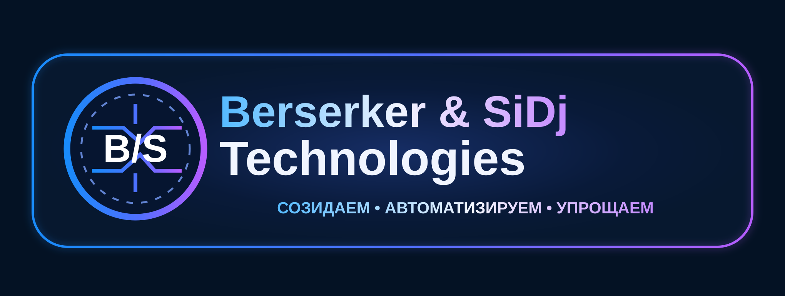

# Berserker & SiDj Technologies

**СОЗИДАЕМ • АВТОМАТИЗИРУЕМ • УПРОЩАЕМ**

Независимая неформальная творческая IT-лаборатория: локальные программы, преобразование файлов, браузерные расширения и ИИ-автоматизация.

- **Название:** Berserker & SiDj Technologies
- **Русское написание:** Берсеркер и СиДжи Технологии
- **Дата основания творческого проекта (со слов основателя):** 20 октября 2026 года
- **Публичный паспорт:** [BRAND.md](BRAND.md)
- **Сайт:** https://berserkerxxxl.github.io/Berserker-SiDj-Technologies/ (после включения GitHub Pages)

## О сайте

Сайт статический: `index.html` и SVG в папке `assets/`. Для включения бесплатного GitHub Pages откройте **Settings → Pages**, выберите **Deploy from a branch → main → /(root)** и нажмите **Save**.

## Фирменные изображения

В этом репозитории опубликована векторная SVG-адаптация неонового знака. Исходное растровое изображение сохранено у основателя проекта и может быть добавлено отдельно.

## Правовой статус

Проект не является зарегистрированным юридическим лицом. Публикация фиксирует использование названия, девиза и изображения в истории коммитов GitHub, но **не заменяет регистрацию товарного знака** и не подтверждает наличие исключительных прав на имя. Вопрос авторско-правовой охраны отдельных элементов, созданных с ИИ, зависит от обстоятельств.
