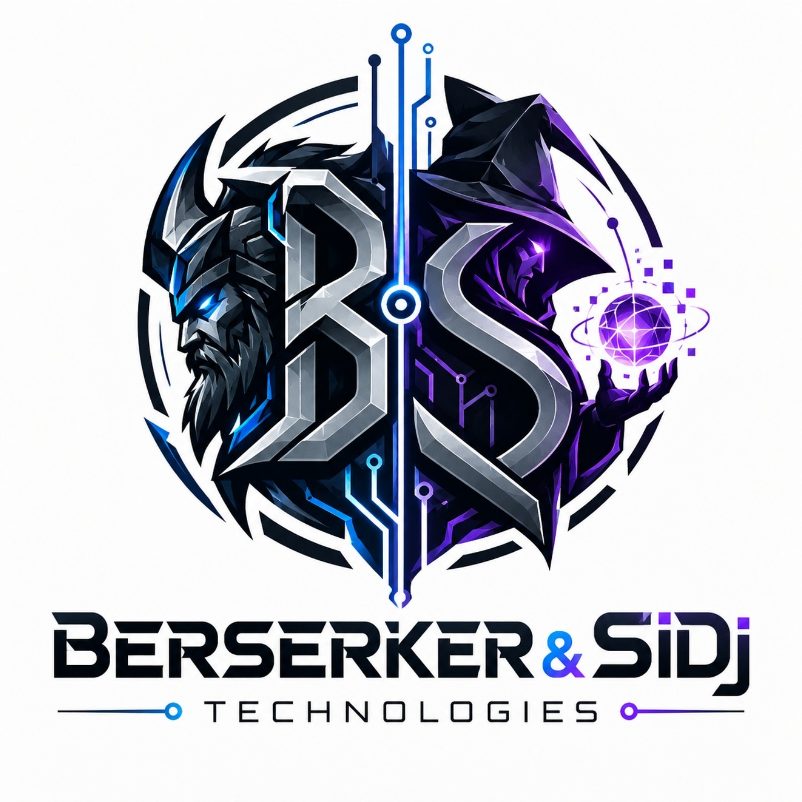

# Berserker & SiDj Technologies

**СОЗИДАЕМ • АВТОМАТИЗИРУЕМ • УПРОЩАЕМ**

Независимая неформальная творческая IT-лаборатория: локальные программы, преобразование файлов, браузерные расширения и ИИ-автоматизация.

- **Название:** Berserker & SiDj Technologies
- **Русское написание:** Берсеркер и СиДжи Технологии
- **Дата основания творческого проекта (со слов основателя):** 20 октября 2026 года
- **Публичный паспорт:** [BRAND.md](BRAND.md)
- **Сайт:** https://berserkerxxxl.github.io/Berserker-SiDj-Technologies/

## Наши разработки

### B/S Excel Converter · билд 2.1.1

Браузерный инструмент для преобразования книг **XLSM → XLSX** с удалением макросов. Дополнительные параметры: удалить лист «Предупреждение», показать скрытые листы, открыть первый оставшийся лист. Библиотека JSZip встроена непосредственно в HTML; загрузка файлов на сервер не требуется.

- [**Запустить конвертер онлайн**](https://berserkerxxxl.github.io/Berserker-SiDj-Technologies/apps/BS_Excel_Converter_2_1_1.html)
- [**Скачать автономный HTML-файл**](apps/BS_Excel_Converter_2_1_1.html) — на GitHub выберите Download raw file или используйте кнопку «Скачать программу» на сайте
- [Карточка разработки на сайте](https://berserkerxxxl.github.io/Berserker-SiDj-Technologies/#projects)

> При конвертации удаляются макросы и связанные элементы. Сохраняйте исходники XLSM; для сложных книг проверяйте результат в Excel. Работа приложения не требует интернет-соединения после скачивания.

## О сайте

Сайт статический и публикуется через бесплатный GitHub Pages из ветки `main`, папки `/(root)`.

## Фирменные изображения

Главная фирменная эмблема с берсерком и магом — [оригинальный JPG 1536×1536](assets/berserker-mage-official.jpg), предоставленный основателем проекта 22 октября 2026 года. Дополнительная векторная адаптация B/S — [SVG](assets/berserker-sidj-logo.svg).

## Правовой статус

Проект не является зарегистрированным юридическим лицом. Публикация фиксирует использование названия, девиза и изображения в истории коммитов GitHub, но **не заменяет регистрацию товарного знака** и не подтверждает наличие исключительных прав на имя. Вопрос авторско-правовой охраны отдельных элементов, созданных с ИИ, зависит от обстоятельств.
